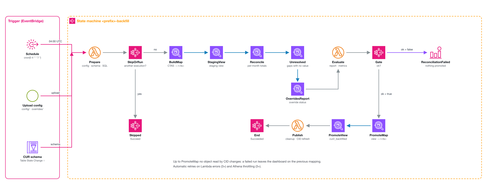

# Backfill missing cost allocation tags in CUR 2.0 with Amazon Athena

> **This is sample code, for non-production usage.** You should work with your security and legal teams to meet
> your organizational security, regulatory and compliance requirements before deployment. Deploying this sample
> creates AWS resources that incur charges (see [Cost](#cost)).

CURCostTagsBackfill rebuilds the cost allocation tags that are missing in CUR 2.0 and exposes them in an
Amazon Athena view, `cur_backfill.cur2_backfilled`, with the same schema as the CUR. The Cloud
Intelligence Dashboards (CUDOS, CID, KPI) read that view instead of the CUR and show costs attributed even
for the months in which the resource did not yet carry the tag.

The typical case: a resource created in June and tagged in September. The native tag backfill does not
cover June–August, because it only works for the months in which the tag was already on the resource.
This tool does.

What it does **not** do: it does not change AWS billing data. Cost Explorer, the Billing console, Budgets
and Cost Categories keep seeing the empty tags in the uncovered period. The original CUR stays intact.

Design notes (objects, rationale, alternatives considered) are in [Design notes](#design-notes).


## Contents

[How it works](#how-it-works) · [Cost](#cost) · [Prerequisites](#prerequisites) · [Regions](#regions) ·
[Deploy](#deploy) · [Deploy without the script](#deploy-without-the-script) · [First run](#first-run) · [Validating a run](#validating-a-run) · [Connecting CID](#connecting-cid-once) ·
[Configuration](#configuration-configbackfilljson) · [Inputs](#inputs) · [Outputs](#outputs) ·
[Operations](#operations) · [Troubleshooting](#troubleshooting) · [Cleanup](#cleanup) ·
[Security](#security) · [Design notes](#design-notes) · [Known limits](#known-limits) · [License](#license)

## How it works



```
config/backfill.json ─┐
overrides/*.csv ──────┼─► EventBridge ─► Step Functions
daily schedule ───────┤                   1. Prepare     (Lambda: config, Glue schema, SQL)
cur2 schema change ───┘                   2. BuildMap    (Athena CTAS: the run's mapping table)
                                          3. StagingView (staging view over the run's mapping)
                                          4. Reconcile   (per-month totals: view = CUR?)
                                          5. Unresolved  (gaps with no value → CSV report)
                                          6. OverridesReport (override rows per status)
                                          7. Evaluate    (Lambda: report, metrics, gate)
                                          8. Promote     (only if reconciliation passes)
                                          9. Publish     (clean up old runs, optional CID refresh)
```

For each resource and key in `tag_keys`, the tool:

1. looks up, in the CUR (the whole history), the native tag values and the month in which they appear;
2. finds the gaps: the months in the configured period in which the resource has rows with an empty key;
3. picks the value for each gap according to `value_strategy` (default `next_seen`: the first value
   applied after the gap);
4. applies the valid CSV overrides, which take priority over discovered values and over the config scope
   (their own period and no account/region/product/resource filters, see [Overrides](#overrides-overridescsv));
5. fills only the rows in which the key is empty. Native values are never touched
   (unless `csv_overrides_native: true`, and only for the CSV values).

The filled rows receive the marker tag `user_tag_backfill` = `derived` or `override`, so that in CID you
can separate costs with a native tag from those with a rebuilt tag.

Before publishing, every run compares rows and costs per month between the staging view and the CUR. If
they do not match, the view used by CID is not updated and an alarm is raised.

## Cost

You pay only for the AWS resources the stack uses. In most accounts the main cost is the data scanned by
Amazon Athena. Prices below are for US East (N. Virginia) at the time of writing; check the
[AWS Pricing Calculator](https://calculator.aws/) for your region.

| Component | Usage per run (one run per day by default) | Notes |
|---|---|---|
| Amazon Athena | the CUR columns read by the mapping CTAS (resource history) and twice by the reconciliation (configured period) | $5 per TB scanned ([pricing](https://aws.amazon.com/athena/pricing/)); `BytesScannedCutoffPerQuery` caps every query |
| AWS Step Functions (Standard) | about 15 state transitions | 4,000 free state transitions per month, then $0.000025 each ([pricing](https://aws.amazon.com/step-functions/pricing/)) |
| AWS Lambda | 3 short invocations | negligible |
| Amazon S3 | mapping tables (Parquet, `KeepRuns` copies), reports, Athena results (30-day lifecycle) | standard S3 rates |
| Amazon CloudWatch | 9 custom metrics, 2 alarms, 2 log groups | the free tier includes 10 custom metrics and 10 alarm metrics ([pricing](https://aws.amazon.com/cloudwatch/pricing/)) |
| AWS KMS (optional) | only if you pass `KmsKeyArn` | key and request charges of your key |

Example: if a run scans 20 GB, the Athena cost is about $0.10 per run, roughly $3 per month with the daily
schedule. To measure your own value, look at `ProcessedBytes` of the `<prefix>-wg` workgroup in CloudWatch
after the first run, then adjust `ScheduleExpression` (for example weekly) if needed. The CID refreshes read
the view instead of the CUR: the extra cost is the JOIN with the small mapping table.

## Prerequisites

- CUR 2.0 (Data Exports) with **resource ID** and an Athena table reading it, in the same region as CID.
- The tag keys to rebuild must be **activated as cost allocation tags**: only then do they appear in
  `resource_tags`. To see the available keys:
  ```sql
  SELECT k, count(*) FROM cid_data_export.cur2 CROSS JOIN UNNEST(map_keys(resource_tags)) AS t(k) GROUP BY 1 ORDER BY 2 DESC
  ```
- An existing S3 bucket in the same region for the Lambda package (`DEPLOY_BUCKET`).
- AWS CLI v2 and credentials with permissions to create the stack (IAM with named roles, Lambda, Step
  Functions, Athena, Glue, S3, EventBridge, CloudWatch, SNS).
- Python 3.12 or later. The Lambda function has no third-party dependencies; the operator scripts
  (`validate_run.py`, `cleanup.py`) need boto3:
  ```bash
  python3 -m venv .venv && .venv/bin/pip install -r requirements.txt
  ```
- Optional, if your organization requires them: a customer managed KMS key in the same region (see
  [Encryption with a customer managed key](#encryption-with-a-customer-managed-key)), a bucket for S3 server
  access logs, an IAM permissions boundary.

## Regions

Deploy the stack in the region of the CUR Athena table and of the CID QuickSight datasets. It uses only
Amazon S3, AWS Glue Data Catalog, Amazon Athena (engine version 3), AWS Lambda (`python3.12`, `arm64`),
AWS Step Functions, Amazon EventBridge, Amazon CloudWatch and Amazon SNS. Check that they are available in
your region in the [AWS Regional Services List](https://aws.amazon.com/about-aws/global-infrastructure/regional-product-services/).

## Structure

```
cloudformation/
  template.yaml            CloudFormation stack (Lambda code: ../src/, packaged by deploy.sh)
src/builder/
  config.py                validation of backfill.json (strict patterns, unknown keys rejected)
  sql.py                   SQL generation (pure, testable without AWS)
  evaluate.py              reconciliation evaluation (pure)
  app.py                   Lambda handler (prepare / evaluate / publish / render)
  validate.py              CLI to validate a config
config/                    examples of backfill.json and overrides.csv
scripts/
  deploy.sh                package + deploy the stack
  upload-config.sh         validate and upload config and overrides (starts a run)
  render_sql.py            render a run's SQL locally, to review or run by hand
  validate_run.py          validate the last run (invariants + independent recomputation, PASS/FAIL)
  cleanup.py               delete the stack and the retained artifacts bucket (dry run by default)
tests/                     unit tests (pytest) + SQL parsing with sqlglot (trino dialect)
tests/athena/              end-to-end Athena test with known answers (3 scenarios + override precedence)
docs/                      architecture and state machine diagrams (PNG for reading, SVG for editing)
.github/workflows/ci.yml   pytest, cfn-lint, Checkov, cfn_nag, Bandit, pip-audit, ShellCheck
pyproject.toml             project metadata (dependencies read from requirements.txt) and pytest configuration
requirements.txt           runtime of the operator scripts (boto3)
requirements-dev.txt       requirements.txt + test and scan tools
```

## Local tests and scans

```bash
python3 -m venv .venv && .venv/bin/pip install -r requirements-dev.txt   # includes requirements.txt
.venv/bin/pytest -q                     # 62 tests
.venv/bin/cfn-lint cloudformation/template.yaml   # only expected warning: W3002 (local Code, needs "package")
.venv/bin/bandit -q -r src scripts      # SQL builders carry "nosec B608", see the note in sql.py
python3 scripts/render_sql.py --config config/backfill.example.json --columns tests/fixtures/cur2_columns.json
```

Checkov (`checkov -f cloudformation/template.yaml --framework cloudformation`) and cfn_nag run in CI. Every skipped rule is
annotated in the template `Metadata` with its justification.

Before the first deploy against a real CUR, run the Athena test with synthetic data:
[`tests/athena/README.md`](tests/athena/README.md).

## Deploy

```bash
export AWS_PROFILE=<profile> AWS_REGION=us-east-1
export DEPLOY_BUCKET=<bucket-for-the-package> CUR_BUCKET=<cur-bucket>
export CUR_DATABASE=cid_data_export CUR_TABLE=cur2 CUR_PREFIX=cur2/
export QS_ROLE=CidCmdQuickSightDataSourceRole      # optional, see below
export NOTIFICATION_EMAIL=finops@example.com       # optional
export RESOURCE_PREFIX=cctb                        # optional, prefix of every named resource
export STACK_TAGS="Environment=dev Owner=finops"  # optional, extra tags on every taggable resource
bash scripts/deploy.sh
```

`QS_ROLE` adds a **read-only** policy on the mapping (`map/*` of the artifacts bucket and database
`cur_backfill`) to the CID QuickSight data source role. Without it, the CID datasets fail with
`PERMISSION_DENIED` when they read the view. The same role must also be able to read the CUR prefix: if
the CUR was not created by the CID stack, add a read-only policy for it.

`deploy.sh` variables:

| Variable | Required | Default | Stack parameter |
|---|---|---|---|
| `AWS_REGION` | yes | — | region of the CUR and of CID |
| `DEPLOY_BUCKET` | yes | — | bucket for the Lambda package |
| `CUR_BUCKET` | yes | — | `CurBucketName` |
| `STACK_NAME` | no | `cur-cost-tags-backfill` | stack name |
| `RESOURCE_PREFIX` | no | `cctb` | `ResourcePrefix` (3–20 chars, lowercase, digits, hyphens) |
| `CUR_DATABASE`, `CUR_TABLE` | no | `cid_data_export`, `cur2` | `CurDatabase`, `CurTable` |
| `CUR_PREFIX` | no | `cur2/` | `CurDataPrefix` (trailing slash, no leading slash) |
| `CUR_KMS_KEY_ARN` | no | empty | `CurKmsKeyArn` (key of the CUR bucket, read only) |
| `WORK_DATABASE` | no | `cur_backfill` | `WorkDatabase` |
| `KMS_KEY_ARN` | no | empty | `KmsKeyArn` (customer managed key for the stack's data) |
| `ACCESS_LOGS_BUCKET` | no | empty | `AccessLogsBucketName` |
| `PERMISSIONS_BOUNDARY_ARN` | no | empty | `PermissionsBoundaryArn` |
| `LOG_RETENTION_DAYS` | no | `90` | `LogRetentionInDays` |
| `QS_ROLE` | no | empty | `QuickSightDataSourceRoleName` |
| `NOTIFICATION_EMAIL` | no | empty | `NotificationEmail` |
| `CID_DATASETS` | no | empty | `CidDatasetIds` (comma separated) |
| `STACK_TAGS` | no | empty | stack tags, `Key=Value` separated by spaces |

Other stack parameters (defaults are used by `deploy.sh`): `PeriodColumn` (`billing_period`),
`CostColumn` (`line_item_unblended_cost`), `ArtifactsBucketName` (generated),
`ScheduleExpression` (`cron(0 4 * * ? *)`), `BytesScannedCutoffPerQuery` (100 GB),
`CostDeltaTolerance` (`0.01`), `KeepRuns` (2). Use a different `ResourcePrefix` and `WorkDatabase` for a
second stack in the same account and region.

Stack outputs: `Version`, `ArtifactsBucket`, `ConfigUri`, `OverridesUri`, `ReportsUri`, `StateMachineArn`,
`BuilderFunctionName`, `AthenaWorkGroup`, `AlarmTopicArn`, `BackfilledView`.

### Deploy without the script

`deploy.sh` only wraps two AWS CLI commands. The template references the Lambda code as a local folder
(`Code: ../src/`, relative to `cloudformation/`), so it must be packaged first: `package` zips `src/`, uploads it
to `DEPLOY_BUCKET` and writes a template that points to the S3 object. Run the commands from the repository root.

```bash
aws cloudformation package \
  --template-file cloudformation/template.yaml \
  --s3-bucket <bucket-for-the-package> --s3-prefix cur-cost-tags-backfill \
  --output-template-file packaged.yaml

aws cloudformation deploy \
  --stack-name cur-cost-tags-backfill \
  --template-file packaged.yaml \
  --capabilities CAPABILITY_NAMED_IAM \
  --tags Application=CURCostTagsBackfill \
  --parameter-overrides CurBucketName=<cur-bucket> CurDatabase=cid_data_export CurTable=cur2 CurDataPrefix=cur2/
```

Add any other parameter from the table above to `--parameter-overrides` (for example
`ResourcePrefix=cctb QuickSightDataSourceRoleName=CidCmdQuickSightDataSourceRole`).

To use the AWS CloudFormation console instead, run only the `package` command, then choose **Create stack**,
**With new resources (standard)**, **Upload a template file**, select `packaged.yaml`, fill in the parameters
and acknowledge that the template may create IAM resources (the stack uses custom role names, which on
the CLI requires `CAPABILITY_NAMED_IAM`). The same `packaged.yaml` works in a CI/CD pipeline.

### Naming and tagging

Every named resource starts with `ResourcePrefix` (default `cctb`):

| Resource | Name |
|---|---|
| Artifacts bucket | `<prefix>-artifacts-<account>-<region>` (or `ArtifactsBucketName`) |
| IAM roles (path `/<prefix>/`) | `<prefix>-builder-<region>`, `<prefix>-statemachine-<region>`, `<prefix>-events-<region>` |
| Lambda function and log group | `<prefix>-builder`, `/aws/lambda/<prefix>-builder` |
| State machine and log group | `<prefix>-backfill`, `/aws/vendedlogs/states/<prefix>-backfill` |
| Athena workgroup | `<prefix>-wg` |
| EventBridge rules | `<prefix>-schedule`, `<prefix>-config-changed`, `<prefix>-schema-changed` |
| SNS topic, alarms | `<prefix>-alarms`, `<prefix>-executions-failed`, `<prefix>-reconciliation` |
| QuickSight read policy | `<prefix>-cid-read` |

The template tags its resources with `Application=CURCostTagsBackfill` and `Version`. Stack tags
(`STACK_TAGS`, or the tags you set in the console) are propagated by CloudFormation to every resource that
supports tags, so organization tag policies (owner, environment, cost center) can be met without editing
the template. Changing `ResourcePrefix` after the first deployment replaces the named resources.

### Encryption with a customer managed key

With `KmsKeyArn` the stack uses your key for the artifacts bucket (SSE-KMS with S3 Bucket Keys), Athena
query results, both log groups, the SNS topic and the Lambda environment, and grants `kms:Decrypt` /
`kms:GenerateDataKey` on that key to its roles and to the QuickSight read policy.

The key must be a symmetric key (`SYMMETRIC_DEFAULT`, `ENCRYPT_DECRYPT`) in the same region as the stack.
Its key policy needs three statements (replace account, region and prefix):

```json
{
  "Version": "2012-10-17",
  "Statement": [
    {
      "Sid": "EnableIamPolicies",
      "Effect": "Allow",
      "Principal": { "AWS": "arn:aws:iam::123456789012:root" },
      "Action": "kms:*",
      "Resource": "*"
    },
    {
      "Sid": "CloudWatchLogsForStackLogGroups",
      "Effect": "Allow",
      "Principal": { "Service": "logs.us-east-1.amazonaws.com" },
      "Action": ["kms:Encrypt*", "kms:Decrypt*", "kms:ReEncrypt*", "kms:GenerateDataKey*", "kms:Describe*"],
      "Resource": "*",
      "Condition": {
        "ArnLike": {
          "kms:EncryptionContext:aws:logs:arn": [
            "arn:aws:logs:us-east-1:123456789012:log-group:/aws/lambda/cctb-builder",
            "arn:aws:logs:us-east-1:123456789012:log-group:/aws/vendedlogs/states/cctb-backfill"
          ]
        }
      }
    },
    {
      "Sid": "CloudWatchAlarmsToEncryptedTopic",
      "Effect": "Allow",
      "Principal": { "Service": "cloudwatch.amazonaws.com" },
      "Action": ["kms:GenerateDataKey*", "kms:Decrypt"],
      "Resource": "*",
      "Condition": { "StringEquals": { "aws:SourceAccount": "123456789012" } }
    }
  ]
}
```

- `EnableIamPolicies` is the default statement of a key: without it, the IAM policies that the stack attaches
  to its roles have no effect ([default key policy](https://docs.aws.amazon.com/kms/latest/developerguide/key-policy-default.html)).
- `CloudWatchLogsForStackLogGroups` lets CloudWatch Logs encrypt the two log groups of the stack, and only those
  ([CloudWatch Logs encryption](https://docs.aws.amazon.com/AmazonCloudWatch/latest/logs/encrypt-log-data-kms.html)).
- `CloudWatchAlarmsToEncryptedTopic` lets the alarms publish to the encrypted topic
  ([SNS encryption](https://docs.aws.amazon.com/sns/latest/dg/sns-key-management.html)).

Amazon S3, Athena, Lambda and QuickSight use the credentials of the stack roles, so they need no extra statement.

People also need permissions on the key, through IAM or the key policy:

| Who | Actions | Why |
|---|---|---|
| Principal that deploys the stack | `kms:DescribeKey`, `kms:CreateGrant`, `kms:Encrypt` | log groups created with a key, Lambda environment encrypted with a customer managed key ([Lambda](https://docs.aws.amazon.com/lambda/latest/dg/configuration-envvars-encryption.html)) |
| Operators (`upload-config.sh`, `validate_run.py`, queries in the `<prefix>-wg` workgroup, reading reports) | `kms:Decrypt`, `kms:GenerateDataKey` | objects and query results are encrypted with the key |

## First run

```bash
cp config/backfill.example.json my-backfill.json    # edit period, tag_keys, filters
bash scripts/upload-config.sh <ArtifactsBucket> my-backfill.json [overrides.csv ...]
```

The upload starts the run. Results:
- `s3://<ArtifactsBucket>/reports/latest-summary.json`: per-month reconciliation, rebuilt rows and costs,
  total unresolved gaps, override counts, problems;
- `s3://<ArtifactsBucket>/reports/unresolved-latest.csv`: the 10,000 most expensive gaps with no value
  (override candidates).

Notifications: the alarms (failed run, failed reconciliation) publish to the `<prefix>-alarms` SNS topic. If you
deployed without `NOTIFICATION_EMAIL`, the topic has no subscriber and a failure is silent: redeploy with an
address and confirm the subscription email, or subscribe your own endpoint to `AlarmTopicArn`.

## Validating a run

`scripts/validate_run.py` checks the last run of a stack without relying on previous runs. It reads every
name from the stack (outputs and Lambda environment) and runs a few Athena queries:

```bash
python3 scripts/validate_run.py --stack-name cur-cost-tags-backfill --region <region>
```

| Check | What it verifies |
|---|---|
| V1 totals | rows and cost per month are equal in the CUR and in the view (from `summary.json`) |
| V2 native kept | no native tag value loses rows in the view: native values are never overwritten |
| V3 provenance | every rebuilt value exists in the native history of the same resource and key |
| V4 scope | rows with the marker are inside the configured period, line item types and filters (override rows excepted) |
| V5 oracle | the mapping equals an independent recomputation of `next_seen` (window function instead of `min_by`/`max_by`); it also reports how much was rebuilt from a later month (tagged later) and from an earlier month only (tag removed later) |
| V6 spot check | month-by-month native and view values for 5 pseudo-random rebuilt resources |

The script prints PASS/FAIL per check and the data scanned, and exits with code 1 if a check fails. On a
CUR of 112 M rows it scanned about 9 GB. For a test with known answers on synthetic data, see
[`tests/athena/README.md`](tests/athena/README.md).

## Connecting CID (once)

After the first successful run, point CID to the view and select the tags (the CID taxonomy is managed
only with cid-cmd). Run it once per dashboard:

```bash
cid-cmd update --force --recursive     # interactive
cid-cmd refresh
```

Answers to the prompts:

| Prompt | Answer |
|---|---|
| Dashboard | the dashboard to update (repeat the command for each one) |
| Athena workgroup | the workgroup CID already uses (`CID` or `primary`), not `<prefix>-wg` |
| CUR table | `cur_backfill.cur2_backfilled` (not `cur2_backfilled_staging`) |
| Cost allocation tags | the keys in `tag_keys` plus the marker; cid-cmd renames `user_<key>` to `tag_<key>`, so the marker is `tag_tag_backfill` |
| Merge columns into single dimensions | `no` |
| Taxonomy fields for filters and group by | the same tags, including `tag_tag_backfill` |

Non-interactive form, with the same answers:

```bash
cid-cmd update --force --recursive --dashboard-id <id> \
  --cur-database cur_backfill --cur-table-name cur2_backfilled \
  --resource-tags tag_<key1>,tag_<key2>,tag_tag_backfill
```

cid-cmd lists the available tags by sampling the last 60 days of the table: the marker appears only if that
window contains rebuilt rows. Every added tag increases the cardinality of the SPICE datasets: pick only the
ones you need.

cid-cmd creates its views (`summary_view`, `resource_view`, `hourly_view`, …) in the Athena database it is
pointed to, here `cur_backfill`; the previous ones stay where they were. The stack never touches them, but
deleting the stack drops the `cur_backfill` database with them: roll CID back first (see [Cleanup](#cleanup)).

To check the result, compare in Athena the monthly totals of `cur_backfill.summary_view` (the source of the
SPICE dataset) with the CUR. The total per month must not change; the cost with an empty key goes down by
exactly the cost marked `derived`:

```sql
SELECT date_format(billing_period, '%Y-%m') AS month,
       round(sum(unblended_cost), 2) AS total,
       round(sum(CASE WHEN coalesce(json_extract_scalar(tags_json, '$.tag_<key>'), '') = '' THEN unblended_cost END), 2) AS no_tag,
       round(sum(CASE WHEN json_extract_scalar(tags_json, '$.tag_tag_backfill') = 'derived' THEN unblended_cost END), 2) AS derived
FROM cur_backfill.summary_view
GROUP BY 1 ORDER BY 1
```

To roll back: run `cid-cmd update --force --recursive` again and select the original CUR table (for example
`cid_data_export.cur2`), with the same tags except `tag_tag_backfill`.

## Configuration (`config/backfill.json`)

| Key | Required | Default | Notes |
|---|---|---|---|
| `period_start`, `period_end` | yes | — | `YYYY-MM`; months that discovery can fill, and the default period of overrides |
| `tag_keys` | yes | — | keys as they appear in `resource_tags` (e.g. `user_cost_center`) |
| `accounts` | no | all | 12-digit IDs |
| `regions` | no | all | `product_region_code` |
| `product_codes` | no | all | `line_item_product_code` (e.g. `AmazonEC2`) |
| `resource_id_patterns` | no | all | exact IDs or LIKE patterns (`*` = `%`) |
| `line_item_types` | no | Usage, DiscountedUsage, SavingsPlanCoveredUsage | |
| `value_strategy` | no | `next_seen` | `next_seen`, `latest`, `first_seen`, `csv_only` |
| `csv_overrides_native` | no | `false` | if `true`, CSV overrides win over native values too |
| `marker_key` | no | `user_tag_backfill` | key added to the filled rows |

Validation rules (applied locally by `upload-config.sh` and again by the Lambda): unknown keys are
rejected; periods are `YYYY-MM` with start ≤ end; `accounts` are 12-digit IDs; `regions` look like
`eu-south-1`; tag keys use letters, digits, space and `_ : - . / @ + =`; `line_item_types` are letters only;
`marker_key` must not be one of `tag_keys`. Check a file without AWS:

```bash
PYTHONPATH=src python3 -m builder.validate my-backfill.json
```

## Inputs

### CUR 2.0 table (read only)

The table set with `CurDatabase` / `CurTable` must contain at least these columns; all the other columns
are carried over unchanged, in the same order. If one is missing the run stops in `Prepare`.

| Column | Type | Used for |
|---|---|---|
| `billing_period` (`PeriodColumn`) | string `YYYY-MM` | period filter, JOIN with the mapping, reconciliation |
| `line_item_usage_account_id` | string | resource identity, `accounts` filter |
| `line_item_resource_id` | string | resource identity; empty or NULL rows are never touched |
| `line_item_line_item_type` | string | `line_item_types` filter |
| `line_item_product_code` | string | `product_codes` filter |
| `product_region_code` | string | `regions` filter |
| `line_item_usage_start_date` | timestamp | order of values within a month |
| `resource_tags` | `map<string,string>` | native values; the only column rewritten in the view |
| `line_item_unblended_cost` (`CostColumn`) | double | reconciliation and report costs |

### Overrides (`overrides/*.csv`)

Values set by hand for specific resources, typically the ones listed in `unresolved-latest.csv`
(scenario C). Every `.csv` file in `overrides/` is read; the first line of each file is the header.

```
account_id,resource_id,tag_key,tag_value,period_start,period_end
123456789012,vol-0abc123def4567890,user_cost_center,CC-123,,
123456789012,i-0123456789abcdef0,user_project,alpha,2026-06,2026-07
123456789012,arn:aws:lambda:eu-south-1:123456789012:function:billing-api,user_cost_center,CC-200,,
```

| Column | Required | Meaning |
|---|---|---|
| `account_id` | yes | 12-digit usage account (`line_item_usage_account_id`) |
| `resource_id` | yes | exact value of `line_item_resource_id`; the format depends on the service (`i-…` for EC2, `vol-…` for EBS, an ARN for Lambda, the bucket name for S3): copy it from `unresolved-latest.csv` or from the CUR |
| `tag_key` | yes | must be one of `tag_keys` in the config, otherwise the row is ignored |
| `tag_value` | yes | value to assign; empty values are ignored |
| `period_start` | no | `YYYY-MM`; empty = `period_start` of the config. May be earlier than the config period |
| `period_end` | no | `YYYY-MM`; empty = `period_end` of the config. May be later than the config period |

A valid override **wins over the config**:

- its period is used as is, also when it extends beyond `period_start` / `period_end` of the config;
- the `accounts`, `regions`, `product_codes` and `resource_id_patterns` filters do not apply to it: the
  override names its resource explicitly;
- only `line_item_types` still applies (taxes, fees and credits are never attributed), and rows with an
  empty resource ID are never touched.

A row is valid when `account_id`, `resource_id`, `tag_key` and `tag_value` are not empty, `tag_key` is in
`tag_keys`, both periods are `YYYY-MM` and start ≤ end. Invalid rows are ignored, never fail the run, and
are counted in `summary.json` → `overrides` with their reason:

| Status | Meaning |
|---|---|
| `applied` | valid, and it filled (or forced) at least one month |
| `valid_not_applied` | valid but without effect: no CUR rows for that resource and period, only excluded line item types, or the key is already populated (and `csv_overrides_native` is `false`) |
| `missing_account_or_resource` | `account_id` or `resource_id` empty |
| `tag_key_not_in_config` | `tag_key` empty or not in `tag_keys` |
| `empty_value` | `tag_value` empty |
| `invalid_period` | a period that is not `YYYY-MM` |
| `period_start_after_end` | `period_start` later than `period_end` |

Other rules:

- By default an override fills only the resource-months in which the key is empty, and always wins over a
  value discovered in the CUR. Marker: `override`.
- With `csv_overrides_native: true` the override applies to every row of that resource in its period,
  replacing native values too.
- If the same resource, key and month appear twice, the highest value in alphabetical order is used:
  avoid duplicates. Values are trimmed; fields containing a comma must be quoted. Identical rows count once
  in the report.
- Uploading or deleting a CSV starts a run.
- Months outside the config period that an override fills are reconciled too.

## Outputs

| Output | Content |
|---|---|
| `cur_backfill.cur2_backfilled` | the view to give to CID: same columns as the CUR; on filled rows `resource_tags` contains the rebuilt keys plus `user_tag_backfill` = `derived` (value from the CUR) or `override` (value from a CSV); absent on untouched rows |
| `cur_backfill.tag_backfill_map` | mapping of the last valid run: `account_id, resource_id, billing_period, tag_key, tag_value, source, is_forced` |
| `cur_backfill.cur2_backfilled_staging` | view of the last run, also when it failed (for debugging) |
| `reports/latest-summary.json` | `runTable`, `evaluatedAt`, `config`, `ok`, `row_delta`, `cost_delta`, `rows_backfilled`, `cost_backfilled`, `unresolved_gaps` (total, not capped), `periods[]` (per month: rows and costs of CUR and view, backfilled rows and cost, deltas), `problems[]`, `unresolved` (`listed`, `total_gaps`, `total_gap_cost`), `overrides` (number of override rows per status, see above) |
| `reports/unresolved-latest.csv` | the 10,000 most expensive gaps with no value, ordered by cost: `account_id, resource_id, tag_key, billing_period, gap_cost, total_gaps, total_gap_cost` (the last two are the totals over all gaps, repeated on every row) |
| `reports/<runTable>/` | the same two reports for every run |

`gap_cost` sums the gross cost of the usage rows (`line_item_types`) with an empty key. It is not comparable
with the net monthly totals of the reconciliation, which also include Savings Plans negation, credits and
discounts.

From unresolved gaps to overrides: for each row of `unresolved-latest.csv` write
`account_id,resource_id,tag_key,<value>,<billing_period>,<billing_period>` (or leave the two periods empty
to cover the whole configured period), add the override header and upload the file to `overrides/`.

Example query on the view:

```sql
SELECT billing_period,
       coalesce(element_at(resource_tags, 'user_cost_center'), '(no tag)')  AS cost_center,
       coalesce(element_at(resource_tags, 'user_tag_backfill'), 'not rebuilt') AS origin,
       round(sum(line_item_unblended_cost), 2) AS cost
FROM cur_backfill.cur2_backfilled
WHERE billing_period BETWEEN '2026-06' AND '2026-09'
GROUP BY 1, 2, 3
ORDER BY 1, 4 DESC
```

## Scenarios

| | Situation | Result |
|---|---|---|
| A | Resource tagged after creation | Earlier months filled with the current value (marker `derived`), including the hours of the application month before the tag |
| B | Value changed over time (alpha → beta) | With `next_seen` the initial months take alpha; with `latest` they would take beta |
| C | No value in the CUR (resource deleted before the tag) | Stays empty and appears in `unresolved-latest.csv`; resolved with an override (marker `override`) |

## Operations

| Task | How |
|---|---|
| Change period, keys or filters | upload a new `backfill.json`: a run starts |
| Fix resources with no value | turn `reports/unresolved-latest.csv` into an override CSV and upload it to `overrides/` |
| Run now | `aws stepfunctions start-execution --state-machine-arn <StateMachineArn>` |
| Check a run | `aws stepfunctions list-executions --state-machine-arn <StateMachineArn> --max-results 3` and `reports/latest-summary.json` |
| See the SQL without running it | `python3 scripts/render_sql.py --config my-backfill.json --columns columns.json`, or on the stack: `aws lambda invoke --function-name <prefix>-builder --cli-binary-format raw-in-base64-out --payload '{"action":"render"}' out.json` |
| Change the source CUR or parameters | re-run `deploy.sh` with the new variables (update of the same stack), then start a run |
| Pause | `aws events disable-rule --name <prefix>-schedule`; the other triggers fire only on upload or schema change |
| Roll back CID | `cid-cmd update --force --recursive` pointing to the original CUR table |
| Uninstall | see [Cleanup](#cleanup) |

## Troubleshooting

| Symptom | Likely cause | What to do |
|---|---|---|
| Run fails in `Prepare` with a config error | invalid or unknown key in `backfill.json` | fix and re-upload; check with `python3 -m builder.validate` |
| Run fails in `Prepare`: missing required columns | wrong `CurTable`, or a CUR without resource IDs | point to the CUR 2.0 table; enable resource IDs in the export |
| Run ends in `ReconciliationFailed` | view and CUR totals differ for a month | read `problems` in `latest-summary.json`, query `cur2_backfilled_staging`; CID keeps the previous mapping |
| Athena `AccessDenied` on the CUR bucket | `CurDataPrefix` does not match the objects, or SSE-KMS key not set | fix the prefix (no leading `/`); set `CUR_KMS_KEY_ARN` |
| `cost_backfilled` is 0 | keys not in `resource_tags`, no gaps in the period, filters too narrow | list keys with `map_keys`; widen period or filters |
| Many rows in `unresolved-latest.csv` | resources that never had the tag | add overrides, or tag the resources: the next run fills the past months of the period |
| An override has no effect | see its status in `latest-summary.json` → `overrides` | `tag_key_not_in_config`: add the key to `tag_keys`; `valid_not_applied`: check `resource_id` and period against the CUR, or the key is already populated (use `csv_overrides_native` to force it) |
| CID refresh `PERMISSION_DENIED` | QuickSight role cannot read the CUR prefix or `map/` | read-only policy on the CUR prefix; deploy with `QS_ROLE` |
| CID "Dataset changed too much" | cid-cmd changed the dataset columns | wait for the refresh to complete |
| CID datasets ingest 0 rows | CUR table empty for Athena (wrong LOCATION or partitions) | `SELECT billing_period, count(*) FROM <cur> GROUP BY 1`; fix LOCATION / partition projection |
| A run is `Skipped` | another execution was still running | wait, or start it again |
| Stack creation fails on a log group, the SNS topic or the Lambda function with `KmsKeyArn` | key policy does not allow CloudWatch Logs or CloudWatch, or the deploying principal lacks `kms:DescribeKey` / `kms:CreateGrant` / `kms:Encrypt` | see [Encryption with a customer managed key](#encryption-with-a-customer-managed-key) |
| `upload-config.sh`, `validate_run.py` or Athena queries fail with `AccessDenied` / `KMS` after a deploy with `KmsKeyArn` | the operator has no `kms:Decrypt` / `kms:GenerateDataKey` on the key | grant them through IAM or the key policy |
| Alarms do not notify with `KmsKeyArn` | `cloudwatch.amazonaws.com` cannot use the key; the alarm history shows "Failed to execute action" | add the `CloudWatchAlarmsToEncryptedTopic` statement |
| Stack creation fails on an IAM role | a role with the same name exists (another stack with the same `ResourcePrefix` in the region), or a permissions boundary denies the actions | use another `ResourcePrefix`; check the boundary allows the actions listed in `cloudformation/template.yaml` |

## Monitoring

CloudWatch namespace `CURCostTagsBackfill` (dimension `Stack`): `RowDelta`, `CostDelta`, `BackfilledRows`,
`BackfilledCost`, `UnresolvedGaps` (total, not capped), `UnresolvedGapCost`, `ReconciliationOk`, `OverridesApplied`, `OverridesNotApplied`,
`OverridesInvalid`. Alarms `<prefix>-reconciliation` (`ReconciliationOk < 1`) and
`<prefix>-executions-failed` (`ExecutionsFailed` of the state machine) notify the `<prefix>-alarms` SNS
topic. Step Functions errors are logged to `/aws/vendedlogs/states/<prefix>-backfill` (level `ERROR`,
execution data excluded).

## Cleanup

To avoid future charges, remove the sample when you no longer need it:

1. Point CID back to the original CUR table: `cid-cmd update --force --recursive` (for example database
   `cid_data_export`, table `cur2`), then `cid-cmd refresh`, and check that the datasets no longer read from
   `cur_backfill`. If you skip this step, the CID datasets fail: the stack deletion drops the `cur_backfill`
   database, including the CID views that cid-cmd created there.
2. Run the cleanup script, first as a dry run, then with `--yes`:
   ```bash
   python3 scripts/cleanup.py --stack-name cur-cost-tags-backfill --region <region>
   python3 scripts/cleanup.py --stack-name cur-cost-tags-backfill --region <region> --yes
   ```
   It deletes the stack (Lambda, state machine, roles, rules, alarms, topic, workgroup, Glue database with
   its tables and views) and then empties (all object versions) and deletes the artifacts bucket, which the
   stack retains on purpose (`DeletionPolicy: Retain`).
3. Remove any policy you added by hand to the QuickSight role (the one created with `QS_ROLE` is deleted
   with the stack) and the Lambda package in `DEPLOY_BUCKET`.

The CUR, its bucket and the CID resources are not touched.

## Security

See [SECURITY.md](SECURITY.md) for how to report a vulnerability and for the security model.

- On the CUR bucket the tool has read-only access, limited to the `CurDataPrefix` prefix.
- Writes only to the artifacts bucket created by the stack (versioning, public access blocked, TLS 1.2+
  required, SSE-S3 or SSE-KMS) and to its own Glue database.
- Every config value that ends up in SQL is validated with strict patterns and then escaped; identifiers
  are validated and quoted. Athena does not support bind parameters for CTAS and views, hence the
  `nosec B608` markers explained in `src/builder/sql.py`.
- IAM roles are least privilege and scoped to the stack's resources. The only wildcard resources are
  `cloudwatch:PutMetricData` (restricted by namespace) and the CloudWatch Logs delivery actions required by
  Step Functions logging. `quicksight:CreateIngestion` is granted on `dataset/*` only if `CidDatasetIds` is set,
  and the function refreshes only the listed datasets.
- Athena (state machine role) can write only under `map/` and `athena-results/` of the artifacts bucket. The
  `config/` and `overrides/` prefixes, whose uploads start a run, are writable only by operators.
- The Step Functions execution history keeps the inputs and outputs of each state (generated SQL and the
  configuration) for its retention period, even though logging excludes execution data. Restrict
  `states:DescribeExecution` and `states:GetExecutionHistory` to the operators of the backfill.
- Optional controls: `KmsKeyArn`, `AccessLogsBucketName`, `PermissionsBoundaryArn`, `LogRetentionInDays`.
- Static analysis: Checkov and cfn_nag on the template, Bandit on the Python code, pip-audit on the
  development dependencies, ShellCheck on the scripts (`.github/workflows/ci.yml`). Skipped rules are
  justified in the template `Metadata`.
- The artifacts bucket has `DeletionPolicy: Retain`: deleting the stack leaves the data in place (see
  [Cleanup](#cleanup)).

## Design notes

### Why one table per run and two views

In Athena a regular table is not updated in place: it is created with CTAS or dropped. Each run therefore
writes a new mapping table, `tag_backfill_map_r<timestamp>`, and then moves the `tag_backfill_map` view to it.
The swap is atomic: CID always reads either the complete old mapping or the complete new one. The staging
view (`cur2_backfilled_staging`) reads the new table directly, so the reconciliation runs before any object
read by CID changes. With `KeepRuns = 2`, the current and the previous table remain, for comparisons or a
manual rollback.

### Objects and data

| Object | Type | Created by | Role |
|---|---|---|---|
| `<CurDatabase>.<CurTable>` (e.g. `cid_data_export.cur2`) | table | Data Exports / CID | CUR 2.0 source, read only, not owned by the stack |
| `cur_backfill` | database | stack (`WorkDatabase`) | everything the tool writes; separate from the CUR for least privilege and clean deletion |
| `cur_backfill.overrides` | external CSV table | stack | reads `overrides/*.csv` |
| `cur_backfill.tag_backfill_map_r<timestamp>` | Parquet table (CTAS) | each run | the run's mapping: account, resource, month, key, value, source, is_forced |
| `cur_backfill.tag_backfill_map` | view | PromoteMap | points to the latest valid mapping |
| `cur_backfill.cur2_backfilled_staging` | view | StagingView | CUR + the current run's mapping, for reconciliation and debugging |
| `cur_backfill.cur2_backfilled` | view | PromoteView | CUR + valid mapping, same columns as the CUR: the table CID reads |

| Artifacts bucket prefix | Content | Written by | Notes |
|---|---|---|---|
| `config/backfill.json` | period, keys, filters | operator | every upload starts a run |
| `overrides/*.csv` | values set by hand | operator | every upload or deletion starts a run |
| `map/<run>/` | Parquet files of the run tables | Athena (BuildMap) | deleted by Publish beyond `KeepRuns`; read by the QuickSight role |
| `reports/<run>/`, `reports/latest-*` | `summary.json`, `unresolved.csv` | Lambda (Evaluate) | run history |
| `athena-results/` | query results | Athena | 30-day lifecycle |

### Alternatives considered

| Option | Why it does not solve the problem |
|---|---|
| [Native cost allocation tag backfill](https://docs.aws.amazon.com/awsaccountbilling/latest/aboutv2/cost-allocation-backfill.html) | tag values are available only for the months in which the tag was already on the resource |
| Retroactive [Cost Categories](https://docs.aws.amazon.com/awsaccountbilling/latest/aboutv2/create-cost-categories.html) | the [rules](https://docs.aws.amazon.com/aws-cost-management/latest/APIReference/API_CostCategoryRule.html) cannot match on resource ID |
| [CID organizational taxonomy](https://docs.aws.amazon.com/guidance/latest/cloud-intelligence-dashboards/add-org-taxonomy.html) | maps existing tag and account fields; it does not rebuild values that are missing from a row |
| Per-account enrichment ([glue-enrich-cost-and-usage](https://github.com/aws-samples/glue-enrich-cost-and-usage)) or a CSV mapping joined in Athena | account granularity, not resource granularity |

## Known limits

- Rows with no resource ID (taxes, support, SP/RI fees, part of the data transfer) are not attributed.
- The view is not materialized: every CID refresh runs the JOIN with the mapping.
- The rebuilt tags are visible only in Athena and CID, never in Cost Explorer and Billing.
- The "no tag" bucket can become negative once usage is attributed: it keeps the rows the tool never
  attributes (Savings Plans negation, credits, discounts, refunds, taxes, fees), which are often negative.
- CID datasets cover their own time window (for example, `summary_view` keeps the last 7 months): rebuilt
  months older than that window are in the view but not in the dashboards.

## Validation status

Validated end to end on a CUR 2.0 table of 112 M rows (8 months, 143 columns): every
stack state, reconciliation delta 0 in 8/8 months, and all `scripts/validate_run.py` checks passed (no native
value overwritten, every rebuilt value from the same resource's history, mapping identical to the independent
recomputation). Athena engine v3 functions used: `FILTER` in aggregates, `min_by`/`max_by`, `map_concat`
precedence, CTAS, window functions.

Also verified:

- The `tests/athena` known-answer test on Athena (all checks passed).
- A deployment with a customer managed key (`KmsKeyArn`): key set on every resource, run and validation
  passed with the same totals, alarm delivered to the encrypted topic.
- CID (cid-cmd 4.4.18) on the view: `update` accepts `cur2_backfilled` as the CUR table, the datasets read the
  new views, and `summary_view` matches the view to the cent in every month (total, cost without tag, cost
  marked `derived`).

Still to verify:

1. That a CID stack update via CloudFormation does not move CID back to the original table.
2. The shape of the EventBridge `Glue Data Catalog Table State Change` event (`databaseName`, `changedTables`).
   If it does not fire, the daily schedule rebuilds the view anyway.
3. Lake Formation, `CurKmsKeyArn`, S3 access logging and permissions boundaries (not tested end to end).

## Contributing

See [CONTRIBUTING.md](CONTRIBUTING.md). Changes are listed in [CHANGELOG.md](CHANGELOG.md).

## License

This library is licensed under the MIT-0 License. See the [LICENSE](LICENSE) file.
